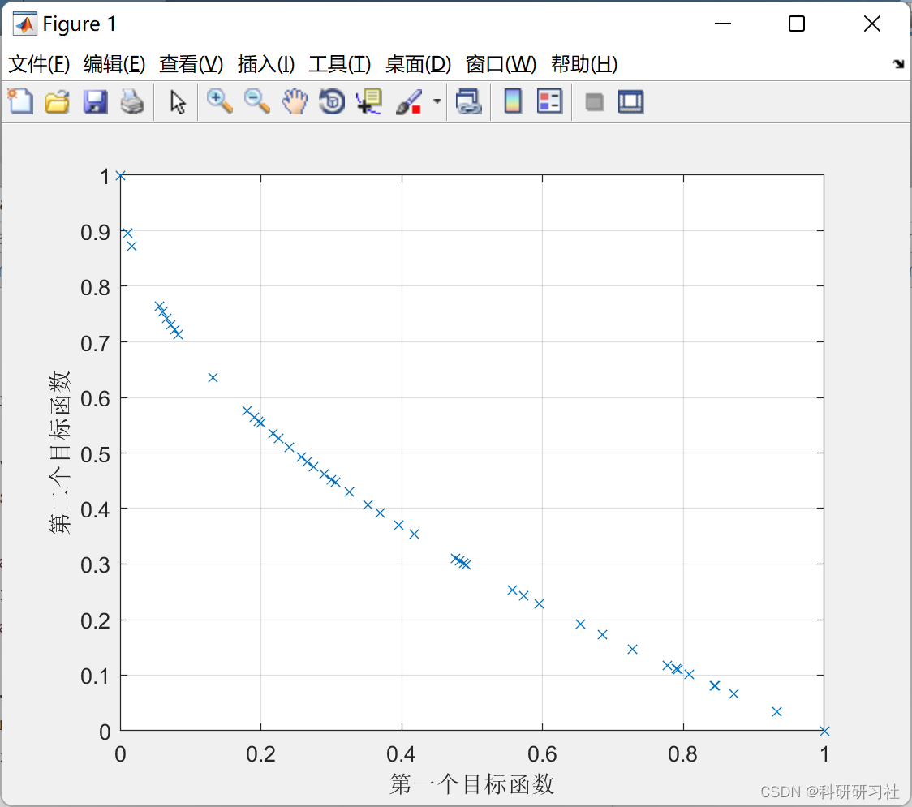

# Pareto Envelope Selection Algorithm (PESA-II) (Matlab Code Implementation)

​  
1. Overview of Evolutionary Algorithms
The Pareto Envelope Selection Algorithm II (PESA-II) is a multi-objective evolutionary optimization algorithm that utilizes the mechanisms of genetic algorithms and the Pareto envelope selection. PESA-II employs an external archive to store approximate Pareto solutions. Parents and offspring are selected from the external archive based on the geographical distribution of its members. This mechanism is very similar to that used in the MOPSO algorithm. In fact, PESA-II is a multi-objective genetic algorithm.
2 PESAII Algorithm Introduction PESAII is a classical evolutionary algorithm for solving multi-objective problems. The algorithm sets up an external population and an internal population. During evolution, non-dominant individuals within the internal population are introduced into the external population, while dominant individuals in the external population are eliminated. When the number of external populations reaches its upper limit, delete the individual with the smallest crowding coefficient from the external population. When the individual's crowding coefficient is the same, randomly remove one and repeat the process until the population size meets the upper limit. Every evolution process will clear the internal population, then select individuals from the external population according to a certain probability of crossover and mutation to obtain new individuals, and add these new individuals into the internal population. The final solution of the algorithm is the external population's individuals, namely several Pareto optimal solutions. Users can select appropriate solutions as needed. For detailed information, refer to Part 4.
3. Running Results Edit 4 Matlab Code to Achieve This article only showcases a portion of the code, and all the code and explanation can be found by clicking the link:
Pareto Envelope Selection Algorithm (PESA-II) (Matlab Code Implementation)
\n\nfunction [y1, y2] = Crossover(x1, x2, params)\n\n    gamma = params.gamma;\n    VarMin = params.VarMin;\n    VarMax = params.VarMax;\n    \n    alpha = unifrnd(-gamma, 1+gamma, size(x1));\n    \n    y1 = alpha.*x1+(1-alpha).*x2;\n    y2 = alpha.*x2+(1-alpha).*x1;\n    \n    y1 = min(max(y1, VarMin), VarMax);\n    y2 = min(max(y2, VarMin), VarMax);\n\nend\n  
5 Results Analysis The results of the experiment reveal that the PSO algorithm's solution relies on the weight coefficients for different objectives; when optimizing a specific objective, it is necessary to modify the corresponding weight. To obtain multiple solutions, the algorithm must be run multiple times. Although the single-run time of the PSO algorithm is shorter than PESAII, when obtaining multiple solutions, PESAII requires less time.
6. References [1] Chen Hao, Du Bin, and Huang Kewei. PESA II algorithm for solving the hot rolling batch planning problem based on PCVRP [J]. Control Engineering, 2011(S1): 86-88120
​  

## Images

<!-- PAYMENT_BLOCK -->

## Get this dataset

- Payment link (Stripe): [Buy now](https://buy.stripe.com/3cs8yP7sY87d0vu9AB)
- Payment QR code: 

<!-- /PAYMENT_BLOCK -->
